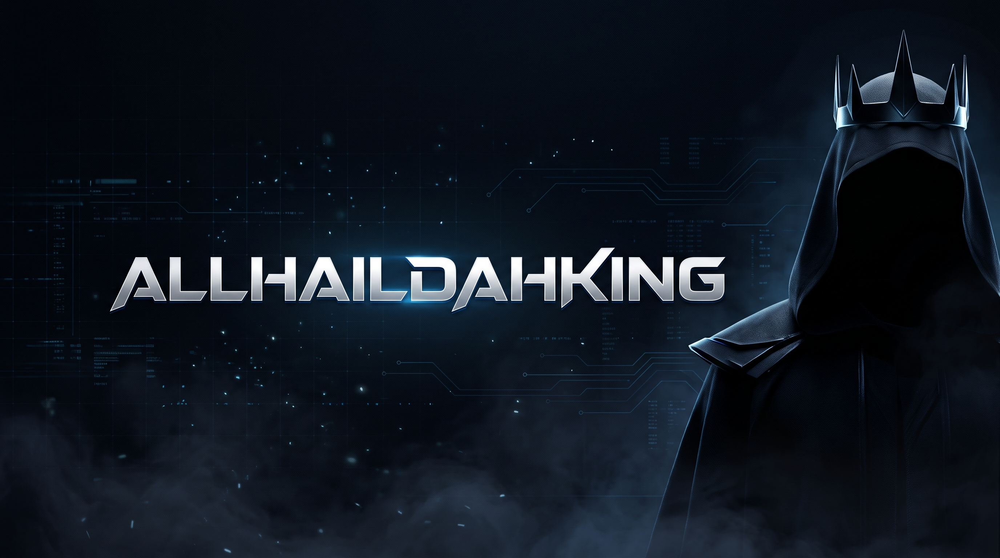

<!-- ALLHAILDAHKING | GitHub profile README -->

  

  <h1>ALLHAILDAHKING</h1>
  
<strong>Independent developer · AI systems · Software builder</strong>

  
  
Turning ideas into useful tools, one system at a time.

  

    
    &nbsp;&nbsp;
    
    &nbsp;&nbsp;
    
    &nbsp;&nbsp;
    
    &nbsp;&nbsp;
    
  

---

## About

I'm an independent developer focused on building software, exploring AI, and understanding how useful products are put together.

I work across backend systems, APIs, interfaces, and automation. I learn by building, testing, breaking things, and improving them.

- Building AI-powered applications and agent-system foundations
- Exploring backend engineering, APIs, and practical automation
- Turning rough ideas into working prototypes

## GitHub overview

  

## Focus areas

- **AI systems** — memory, reasoning, research, planning, and controlled tool use.
- **Backend engineering** — APIs, application logic, and service integrations.
- **Product building** — taking ideas from concept to usable prototypes.
- **Automation** — connecting tools and reducing repetitive work.

## Tech stack

**Languages**

**Backend & data**

**Frontend**

**Tools & platforms**

## Selected work

<table>
  <tr>
    <td width="50%" valign="top">
      <h3><a href="https://github.com/Allhaildahking/M.A.R.S">M.A.R.S</a></h3>
      
A modular AI assistant exploring reasoning, memory, research, task planning, and permissioned tools.

      AI SYSTEMS · PYTHON · FASTAPI
    </td>
    <td width="50%" valign="top">
      <h3><a href="https://github.com/Allhaildahking/Trade-Oracle">Trade Oracle</a></h3>
      
A Forex market-intelligence engine for structured, auditable analysis. No broker execution.

      MARKET ANALYSIS · PYTHON
    </td>
  </tr>
  <tr>
    <td width="50%" valign="top">
      <h3><a href="https://github.com/Allhaildahking/Market-Radar-">Market Radar</a></h3>
      
A market-news pipeline that tracks sources, filters duplicate stories, classifies headlines, and sends Telegram alerts.

      NEWS INTELLIGENCE · AUTOMATION
    </td>
    <td width="50%" valign="top">
      <h3><a href="https://github.com/Allhaildahking/LoreLab">LoreLab</a></h3>
      
An AI-assisted research and production workflow for history-focused storytelling.

      AI · RESEARCH · STORYTELLING
    </td>
  </tr>
  <tr>
    <td width="50%" valign="top">
      <h3><a href="https://github.com/Allhaildahking/BabelLive">BabelLive</a></h3>
      
An early-stage project exploring real-time AI speech translation for live broadcasts.

      AI · SPEECH · TRANSLATION
    </td>
    <td width="50%" valign="top">
      <h3><a href="https://github.com/Allhaildahking/portfolio">Portfolio</a></h3>
      
My personal portfolio and a home for selected work, experiments, and ways to connect.

      WEB DEVELOPMENT · DESIGN
    </td>
  </tr>
</table>

## Currently building

**M.A.R.S.**  
Strengthening the foundations of a modular AI assistant: reliable APIs, memory, research, task planning, and explicit tool permissions.

**Market Radar**  
Improving a lightweight market-news pipeline with source tracking, deduplication, classification, and Telegram delivery.

## Exploring next

- Agent architecture and dependable tool-calling systems
- Memory design, retrieval, and context management
- Python backend engineering and API design
- Practical automation and AI product development

## Open to

- Interesting software and AI collaborations
- Building useful products with other developers
- Learning from people who enjoy solving hard problems

---

  Curious by nature. Building with intention.

